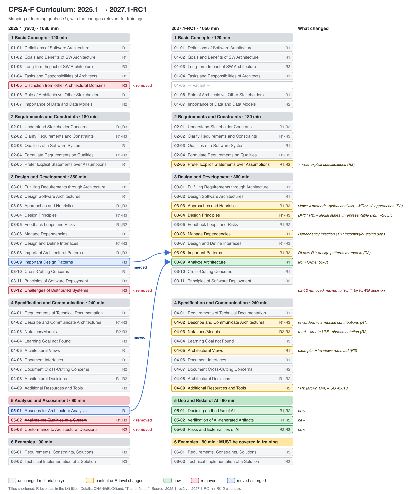
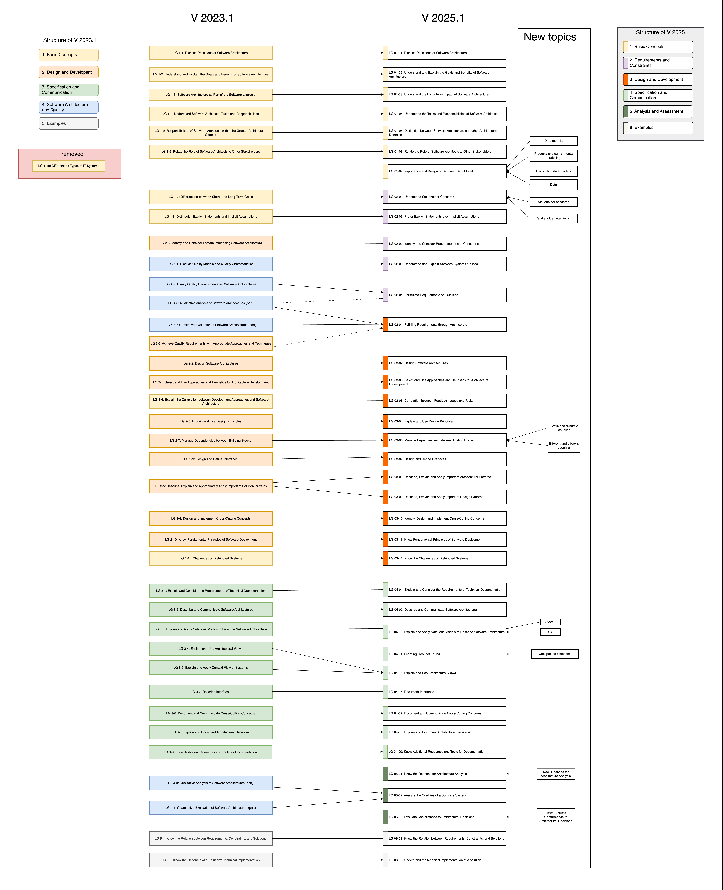

## Table of Contents
- [Trainer Notes: 2025.1 → 2027.1-RC1](#trainer-notes-20251--20271-rc1)
  - [At a Glance](#at-a-glance)
  - [Structure and Timing](#structure-and-timing)
  - [LG Numbers with New Meaning](#lg-numbers-with-new-meaning)
  - [New Content](#new-content)
  - [Changed Content (R1/R2)](#changed-content-r1r2)
  - [Deleted Content](#deleted-content)
  - [Not Changed in RC1 / Still Under Discussion](#not-changed-in-rc1--still-under-discussion)
- [Changes in 2025.1](#changes-in-20251)
  - [Very Short Summary](#very-short-summary)
  - [Summary](#summary)
  - [Detailed Change History](#detailed-change-history)

>#### Abbreviations used below:
>
> * LG: Learning goal
> * LGI: Learning goal item (_bullet item_ within LG)
> * RC: Release candidate
  

# Trainer Notes: 2025.1 → 2027.1-RC1

A short guide for trainers and training providers to the changes that affect training material.
It compares release `2025.1-rev2` with `2027.1-RC1` and focuses on R1/R2 content.
Wording is quoted from the EN version; DE has been changed the same way.
Purely editorial changes (typos, references, build) are not listed.
For all details, see the [full diff](https://github.com/isaqb-org/curriculum-foundation/compare/2025.1-rev2...2027.1-RC1) and the [closed issues labelled V2027](https://github.com/isaqb-org/curriculum-foundation/issues?q=is%3Aissue+is%3Aclosed+label%3AV2027).

**This is a release candidate. Your feedback is welcome in the [issue tracker](https://github.com/isaqb-org/curriculum-foundation/issues).**

## At a Glance

* **New section 5 "Use and Risks of Artificial Intelligence"** (60 min, 3 LGs) replaces the former section 5 "Analysis and Assessment" (90 min).
* **Architecture analysis has been reduced** to a single R1 LG (now LG 03-09). LGs on quality analysis and conformance checking were removed ([#791](https://github.com/isaqb-org/curriculum-foundation/issues/791)).
* **All patterns are now in one LG** (LG 03-08). The distinction between "architectural patterns" and "design patterns" has been dropped ([#772](https://github.com/isaqb-org/curriculum-foundation/issues/772)).
* **Higher exam relevance:** Dependency Injection (R3 → R1), DRY (R3 → R2), LG 04-09 documentation frameworks such as arc42 and C4 (R3 → R2).
* **Removed:** SOLID as a block, distributed systems, architecture domains, global analysis, model-based design, ISO/IEC/IEEE 42010.
* **LG 04-03 (notations)** now requires participants to *read and create* UML diagrams and to *choose* a suitable notation, instead of just *knowing* the diagram types.
* **Section 6 (Examples) MUST now be covered in training** ([#790](https://github.com/isaqb-org/curriculum-foundation/issues/790)). It is still not relevant for the exam.
* The "[previously LG x-y]" and "[new]" markers have been removed from all LG titles.

Overview of all LGs, old vs. new ([SVG version](./documentation/Mapping-2025-2027.svg)):

## Structure and Timing

| Section | 2025.1 | 2027.1-RC1 |
|:--|:--|:--|
| 5 | Analysis and Assessment: 90 min (60 + 30 exercises) | Use and Risks of Artificial Intelligence: 60 min (no exercises) |
| Total | 1080 min | 1050 min |

All other section durations are unchanged.
A new note in the preamble explains that 1050 min nearly equals the net teaching time of three days (4 × 90 min per day).
It also says that breaks, discussions and buffer time are not included and must be planned in addition ([#779](https://github.com/isaqb-org/curriculum-foundation/issues/779)).

## LG Numbers with New Meaning

Please check the LG references in your slides and exercises:

| LG | 2025.1 | 2027.1-RC1 |
|:--|:--|:--|
| 01-05 | Distinction from other architectural domains (R3) | *vacant* |
| 03-08 | Important **Architectural** Patterns (R1, R3) | Important Patterns (R1, R3), including the former LG 03-09 |
| 03-09 | Important Design Patterns (R3) | Analyze Architecture (R1), formerly LG 05-01 |
| 03-12 | Challenges of Distributed Systems (R3) | *deleted* |
| 05-01 | Know Reasons for Architecture Analysis (R1) | Deciding on the Use of AI in Architecture Work (R1, R2) |
| 05-02 | Analyze the Qualities of a Software System (R1, R3) | Verification of AI-generated Artifacts (R1, R2) |
| 05-03 | Evaluate Conformance to Architectural Decisions (R2) | Recognize the risks, ethical and societal externalities of AI (R2, R3) |

## New Content

**Section 5: Use and Risks of Artificial Intelligence** ([#824](https://github.com/isaqb-org/curriculum-foundation/issues/824)). The section sets the foundations only. Advanced Level modules AGENTA (AI-assisted architecture) and SWARC4AI (architecture of AI-based systems) cover these topics in depth.

| LG | Content |
|:--|:--|
| 05-01 (R1, R2) | Decide, based on stated criteria, whether and how to use AI for a task, and justify this as an architectural decision (R2). Explain why delegating tasks to AI agents amplifies the consequences of implicit assumptions (R1). |
| 05-02 (R1, R2) | Responsibility for decisions and artifacts stays with humans (R1). Verifying AI output must be part of the development process (R1). Name verification approaches: review, tests/CI, static analysis, type systems, scenario-based and formal methods (R2). Explain the risks of delegating review and verification to an LLM (R2). |
| 05-03 (R2, R3) | Name the risks of AI use: IP/legal, disclosure of code or data to model providers, prompt injection, loss of skills, dependence on providers and models (R2). Describe the societal externalities: energy/CO₂, labor market, open-source ecosystems, model bias, political destabilization (R3). This LG is a deliberate exception to ADR 011, see [ADR 016](documentation/decisions/016-ai-externalities-exception-to-011.md). |

**Other new content:**

| LG | Content |
|:--|:--|
| 02-05 | *Write explicit specifications of requirements, constraints, edge cases, forbidden actions, and escalation paths, and treat this as an architectural responsibility* (R2). *Explain why good specifications contain unambiguous, general descriptions of the desired behavior, not merely examples* (R1). |
| 03-04 | New principle **Make illegal states unrepresentable**, *as a design principle to improve robustness* (R2) ([#767](https://github.com/isaqb-org/curriculum-foundation/issues/767)) |
| 03-03 | New R3 approaches: *quality-driven software architecture* ([#838](https://github.com/isaqb-org/curriculum-foundation/issues/838)) and *functional software architecture* ([#841](https://github.com/isaqb-org/curriculum-foundation/issues/841)) |
| 04-03 | New R2 items: choose and justify a notation for given stakeholder concerns; justify when text or tables are better than a diagram; quality criteria for diagrams (purpose, legend, level of abstraction, consistency with the text). See the next section for details. |

## Changed Content (R1/R2)

| LG | 2025.1-rev2 | 2027.1-RC1 |
|:--|:--|:--|
| 02-05 | *Prefer Explicit Statements over Implicit Assumptions* (R1). Participants "know that implicit assumptions can lead to misunderstandings" | Now (R1, R2). Participants "can explain why implicit assumptions can lead to misunderstandings" (R1), plus the new items above |
| 03-03 | "name, explain, and use **fundamental approaches of** architecture development" | "name, explain, and use **approaches that support** architecture development" |
| 03-03 | "**view-based architecture development**" (R1) | "**architectural views**" (R1). This is no longer presented as a fixed method ([#784](https://github.com/isaqb-org/curriculum-foundation/issues/784)) |
| 03-04 | Complexity reduction (R3), including DRY | Complexity reduction (R2-R3): **DRY is now R2** ([#836](https://github.com/isaqb-org/curriculum-foundation/issues/836)), KISS/YAGNI/CUPID stay R3 |
| 03-06 | "**efferent and afferent coupling**" | "**incoming and outgoing dependencies**" ([#775](https://github.com/isaqb-org/curriculum-foundation/issues/775)) |
| 03-06 | externalization of dependencies, e.g. Dependency Injection **(R3)** | Dependency Injection **(R1)** ([#801](https://github.com/isaqb-org/curriculum-foundation/issues/801)) |
| 03-08 | "Describe, Explain and Apply Important **Architectural** Patterns". R1: Layers, Pipes and Filters, Microservices. Dependency Injection was in the R3 list | "Describe, Explain and Apply Important Patterns". R1: Layers, Pipes and Filters, Microservices, **Dependency Injection**. The R3 list now also contains the former design patterns (Combinator, Adapter/Facade/Proxy, Interpreter, Observer, Template Method/Strategy, Visitor). GoF has been added as a source |
| 03-09 | *Know Reasons for Architecture Analysis* (R1) as LG 05-01: "identify risks and possible improvements in the architecture design (before, during, or after implementation)" | *Analyze Architecture* (R1) as LG 03-09: same four items. The phrase "(before, during, or after implementation)" has been dropped |
| 04-02 | Participants "know (R1) the benefits of template-based documentation" and "know that various properties of documentation depend on …" | Participants "can (R1) **explain** the benefits of template-based documentation" and "**describe how** various properties of documentation depend on …" |
| 04-02 | "measures to support the consistency of written and verbal communication, and balance one against the other" | "measures that keep verbal and written communication aligned with one another and appropriately balanced" ([#793](https://github.com/isaqb-org/curriculum-foundation/issues/793)) |
| 04-02 | Situational adjustment (R3) of 5 characteristics: amount/detail, format, accessibility, formality, formal reviews/sign-off | One sentence: "adapt the scope, detail, format, and accessibility of documentation to the situation" (R3) ([#794](https://github.com/isaqb-org/curriculum-foundation/issues/794)) |
| 04-03 | "**know** at least the following UML diagrams": class, package, component (R2), composite structure (R3), deployment (R2), sequence/activity (R2), state (R3) | "are able to **read** … and to **create** them for simple systems (R2)": package/component/class (building block and context view), sequence/activity (runtime view), deployment (deployment view). State and composite structure diagrams are now in the R3 overview list ([#795](https://github.com/isaqb-org/curriculum-foundation/issues/795)) |
| 04-03 | "know alternative notations to UML" (R3): ArchiMate, SysML, C4, ERD, flow charts, numbered lists, BPMN | "know further notations at an overview level and … relate them to their primary intended use" (R3). Numbered lists now appear under the R2 item on text and tables |
| 04-05 | Additional views "such as functional safety, information view, operational view or user-interface view" (R3) | The examples have been removed: "Additional views might be used as needed …" (R3) |
| 04-09 | *Know Additional Resources and Tools for Documentation* **(R3)**: ISO/IEC/IEEE 42010, arc42, C4 | **(R2)**: arc42, C4. ISO 42010 has been removed ([#798](https://github.com/isaqb-org/curriculum-foundation/issues/798)) |

**Terminology** (in all sections):
* "architectural pattern" / "design pattern" are now simply "pattern" (DE: "Architekturmuster"/"Entwurfsmuster" → "Muster").
* DE: "Trennung von Verantwortlichkeiten" → "Trennung von Belangen" (Separation of Concerns). "Layer" → "Schichten (Layers)".

## Deleted Content

| Former LG / item | Level | Note |
|:--|:--|:--|
| LG 01-05 Distinction from other architectural domains | R3 | [#787](https://github.com/isaqb-org/curriculum-foundation/issues/787). The LG number is vacant. |
| LG 03-12 Challenges of distributed systems | R3 | Moved to "FL II" by FLWG decision ([#828](https://github.com/isaqb-org/curriculum-foundation/issues/828)) |
| LG 05-02 Analyze the qualities of a software system: analysis methods (acceptance tests, run-time measurement, scenario-based analysis, metrics, ATAM, …) and sources of information for quality analysis | **R1**, R3 | [#791](https://github.com/isaqb-org/curriculum-foundation/issues/791). Covered by the Advanced Level (IMPROVE, AWERT). Static analysis now appears only as a verification approach in LG 05-02 (AI). |
| LG 05-03 Evaluate conformance to architectural decisions | **R2** | [#791](https://github.com/isaqb-org/curriculum-foundation/issues/791) |
| LG 03-04 SOLID principles as a block | R3 | [#859](https://github.com/isaqb-org/curriculum-foundation/issues/859). The Open/closed and Dependency inversion principles (R1, Modularization) and Liskov (R3, Conceptual integrity) remain. |
| LG 03-03 Global analysis, model-based design | R3 | [#799](https://github.com/isaqb-org/curriculum-foundation/issues/799), [#800](https://github.com/isaqb-org/curriculum-foundation/issues/800) |
| LG 03-08 "that there are different categories of patterns" | R3 | follows from merging the pattern LGs |
| LG 04-02 "consolidate and harmonise the style and content of contributions from different groups of authors" | **R1** | [#792](https://github.com/isaqb-org/curriculum-foundation/issues/792) |
| LG 04-02 formality of documentation, formal reviews and sign-off processes | R3 | [#794](https://github.com/isaqb-org/curriculum-foundation/issues/794) |
| ISO/IEC/IEEE 42010 (LG 04-09, references of LG 01-01) | R3 | [#798](https://github.com/isaqb-org/curriculum-foundation/issues/798) |

## Not Changed in RC1 / Still Under Discussion

* **Data and data models (LG 01-07, R2) have not changed** compared to 2025.1. Rewording is still being discussed in [#774](https://github.com/isaqb-org/curriculum-foundation/issues/774) and [#768](https://github.com/isaqb-org/curriculum-foundation/issues/768).
* Open topics that may affect the final 2027.1 release include agent terminology aligned with AGENTA ([#867](https://github.com/isaqb-org/curriculum-foundation/issues/867)), LG 03-03 approaches ([#839](https://github.com/isaqb-org/curriculum-foundation/issues/839), [#853](https://github.com/isaqb-org/curriculum-foundation/issues/853)) and reorganizing section 4 ([#814](https://github.com/isaqb-org/curriculum-foundation/issues/814)).
* Future LG wording will follow the new [list of operators](documentation/didactics/operators-learning-goals.md) (verbs such as *name*, *explain*, *assess*), see [#850](https://github.com/isaqb-org/curriculum-foundation/issues/850).

---

# Changes in 2025.1

The baseline for the following comparison is the latest release of 2023.1

The list of fixed/resolved issues can be found in the [Kanban board](https://github.com/orgs/isaqb-org/projects/7/views/1) on GitHub.
For 2025.1, we have resolved more than 60 issues, comments and problems in both the English (EN) and German (DE) version.

## Very Short Summary

* The structure of the curriculum has been aligned with the architectural tasks (clarify requirements, design the system, communicate, evaluate/analyze)
* As a consequence, many learning goals have been moved.
* Examination-relevant content largely remained unchanged.
* Many LGs got new numbers, but the old numbers are kept in the title to facilitate migration.   

## Summary

The new version is structured along the fundamental activities and responsibilities of software architecture as a role, preceeded by some basic concepts:

| Section | Content |
|:----|-------|
| 1| Basic concepts |
| 2 | Clarifying stakeholder requirements and constraints|
| 3|  Designing and developing software architectures, taking structural and conceptual decisions|
| 4|  Communicating and documenting the architecture for various stakeholders|
| 5|  Analyzing and assessing software architectures|
| 6| Examples of software architectures |

####  The following topics have been removed:

* Software Lifecycle
* Differentiate types of IT systems

> Correction: the "Expect errors" principle (LG 03-04) was not removed, as an earlier version of this list claimed. Its relevance was lowered from R1-R2 to R2-R3.

#### The following topics are new in V2025:

* Data models
* Stakeholder concerns + interviews
* Static and dynamic coupling
* Efferent and afferent coupling
* SysML, C4
* Deal with unexpected situations
* Reasons for architecture analysis
* Evaluate conformance to architectural decisions

The mapping of V2023 to V2025 is provided in graphical format for your convenience:

## Detailed Change History

In case you are curious, take a look at the [change history](https://github.com/isaqb-org/curriculum-foundation/activity). 
Work relevant for 2025.1 has begun October 2023, and is documented by detailed commits to the repository.

>Count commits across all branches:
>`git rev-list --all --count --since="23 October 2023"`

